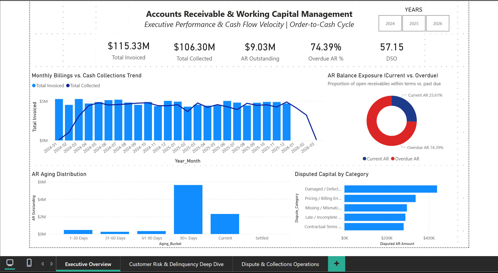

# Accounts Receivable & Working Capital Analytics

### Collections, Overdue Exposure, Customer Risk and Dispute Operations Dashboard


[](screenshots/01_Executive_Overview.png)

*Select the image to view it at full size.*

---

## Project Overview

Finance and collections teams need more than a total outstanding balance. They need to know what has been billed and collected, how much receivable is overdue and how old it is, which customers and risk tiers carry the exposure, and how much cash is tied up in disputes.

This project simulates two years of invoicing and payments for a company with 150 customers and builds a three-page Power BI dashboard on top of it. The dashboard supports three decisions: where collections effort should go, whether the customer risk tiers are working, and which dispute owners need to resolve their queues.

### Data Source

**Data Source:** Synthetically generated for this project using Python with a fixed random seed, so results are reproducible. The company, records, and business scenarios are fictional and are intended for learning and portfolio demonstration.

---

## Key Metrics (as of 31 December 2025)

| Total Invoiced | Collected to Date | AR Outstanding | Overdue AR | DSO | Disputed AR |
| --- | --- | --- | --- | --- | --- |
| **$115.33M** | **$98.81M** (85.7%) | **$16.52M** | **$7.73M** (46.8%) | **104.7 days** | **$1.64M** (192 disputes) |

---

## Key Findings

1. **Most billing has been collected, but a large balance remains open.** $98.81M of $115.33M was collected by 31 December 2025, leaving $16.52M outstanding. Of that, $8.80M is current and $7.73M is overdue.
2. **Overdue balances are concentrated in very old invoices.** The 90+ day bucket holds $5.65M: 34% of outstanding AR and 73% of overdue AR. The 1–30, 31–60 and 61–90 day buckets hold $1.06M, $0.55M and $0.46M.
3. **Customer risk tiers do not match where overdue money sits.** Low-risk customers hold $5.49M of overdue AR (71%). High-risk customers hold $0.56M (7%), though they are 21 of the 150 customers. In this dataset, the risk tiers do not predict late payment.
4. **Overdue exposure is spread across customers.** 148 of 150 customers have at least one overdue invoice, so the overdue-customer count does not rank accounts. The three largest overdue balances are Client Corp 0011 ($268K), 0126 ($260K) and 0037 ($253K).
5. **Open disputes tie up $1.64M across 192 invoices.** Quality Assurance (damaged or defective goods) holds $439K (27%). Billing & Finance (pricing and billing errors) holds $338K (21%). Sales Operations holds $296K (18%), Supply Chain & Logistics $289K (18%), and Legal & Commercial $281K (17%).
6. **DSO is 104.7 days** against standard payment terms of 30 to 90 days.

**What these findings do not show:** Results come from simulated behaviour. Every open dispute is unpaid by construction, so the disputed-AR figure partly reflects the data design rather than an observed pattern. The risk-tier finding describes this dataset, not real customers.

---

## Business Problem and Objectives

Accounts receivable teams need to understand exposure, not only totals. The project aims to:

1. Monitor billing, collections and outstanding receivables.
2. Analyse aging and delinquency exposure.
3. Identify high-risk customers and concentrated overdue balances.
4. Support invoice-level collection priorities.
5. Analyse disputed receivables by category and owner.
6. Provide management views for collection and dispute follow-up.

---

## Methodology and Definitions

- **As-of date:** 31 December 2025. All balances, aging buckets and overdue figures use this date. Payments dated later are excluded from outstanding balances.
- **AR Outstanding:** invoice amount less payments received by the as-of date.
- **Overdue AR:** outstanding balance past its due date at the as-of date.
- **Aging buckets:** days past due, in the bands Current, 1–30, 31–60, 61–90 and 90+.
- **Collection Efficiency:** total collected ÷ total invoiced.
- **DSO:** AR outstanding ÷ total invoiced × 731 days, the number of days from 1 January 2024 to 31 December 2025 inclusive.
- **Disputed AR:** outstanding balance on invoices whose dispute status is Open.

Full formulas are in [`documentation/dax_measures.md`](documentation/dax_measures.md).

**Tools:** Python (NumPy for seeded generation, pandas for preparation and checks) and Power BI Desktop (data model, DAX measures, three report pages).

**Data model:** two fact tables (invoices and payments), two dimensions (customers and dispute reasons), and a date table. Payments link to invoices. Invoices link to customers and dispute reasons.

**Checks performed:** keys are unique; every payment matches an invoice; no payment predates its invoice; due dates match payment terms; no invoice is overpaid; invoiced minus collected equals outstanding.

---

## Dashboard

1. **[Executive Overview](screenshots/01_Executive_Overview.png):** headline KPIs, monthly billings against collections, current versus overdue AR, aging distribution, disputed AR by category. Slicer: year.
2. **[Customer Risk & Delinquency Deep Dive](screenshots/02_Customer_Deep_Dive.png):** overdue customers and exposure, overdue AR by risk tier, top 10 delinquent accounts, and a prioritised collection table.
3. **[Dispute & Collections Operations](screenshots/03_Dispute_Operations.png):** disputed AR by operational owner, dispute categories by aging bucket, and the escalated dispute queue, which lists open disputes only.

---

## Repository Structure

```text
ar-working-capital-analytics/
├── README.md
├── dashboard/
│   └── AR_Working_Capital_Analytics.pbix
├── data/
│   ├── raw/
│   │   ├── Dim_Customer.csv
│   │   ├── Dim_Dispute_Reason.csv
│   │   ├── Fact_AR_Invoices.csv
│   │   └── Fact_AR_Payments.csv
│   └── processed/
│       └── Dim_dates.csv
├── documentation/
│   ├── data_dictionary.md
│   └── dax_measures.md
├── script/
│   └── 01_generate_data.py
└── screenshots/
    ├── 01_Executive_Overview.png
    ├── 02_Customer_Deep_Dive.png
    └── 03_Dispute_Operations.png
```

---

## How to Reproduce

```bash
pip install numpy pandas
python script/01_generate_data.py
```

The script writes the four raw tables to `data/raw/` using seed 42.

**Dashboard:** open `dashboard/AR_Working_Capital_Analytics.pbix` in Power BI Desktop. If the file path does not resolve, point each source to the matching file in `data/` (Home > Transform data > Data source settings).

---

## Limitations

- **Simulated data.** Payment behaviour, risk tiers and disputes are set by fixed probabilities in the generator.
- **Payments after the cutoff.** The generator records payments up to about March 2026. Invoices from late 2025 that would have been paid later show as unpaid at 31 December 2025.
- **Snapshot view only.** There is no time series of aging.
- **Open disputes are unpaid by construction.**
- **No cash-application detail.** No partial-payment reasons, credit notes or write-offs.
- **Risk tiers are randomly assigned** in the generator, so their weak link to overdue balances reflects how the data was built.

---

## Disclaimer

This is a portfolio project using simulated data. The company, customers, invoices, payments and scenarios are fictional. Results describe this dataset only and should not be read as evidence about any real organisation.

---

**Author:** [Sarthak Jaykar](https://www.linkedin.com/in/sarthak-jaykar/)
